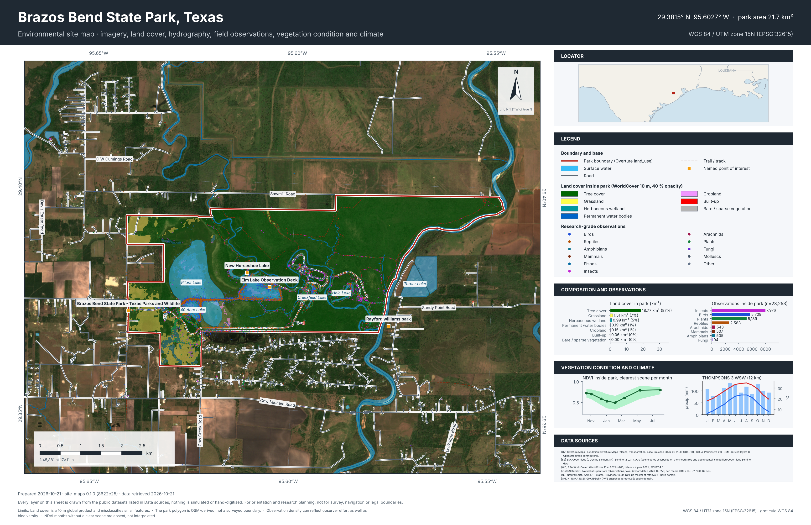
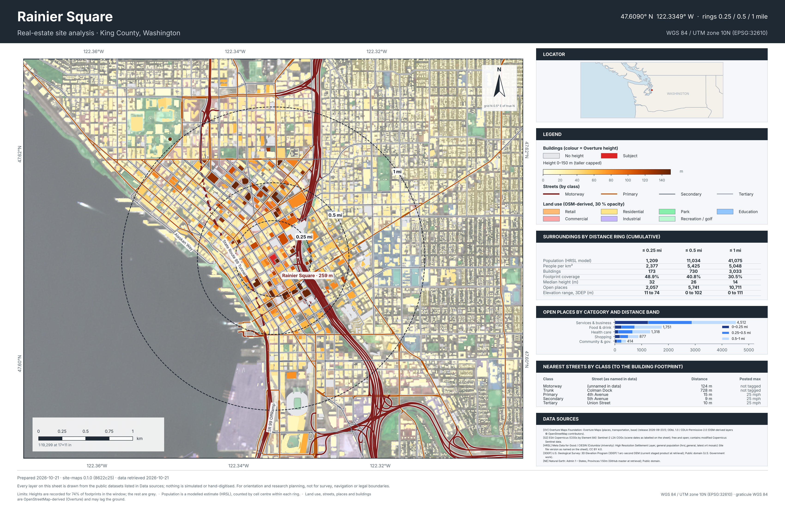
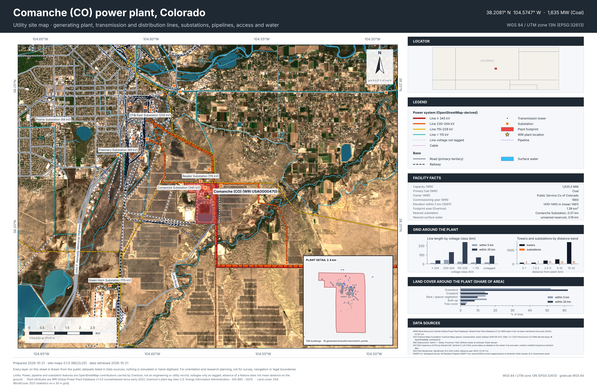
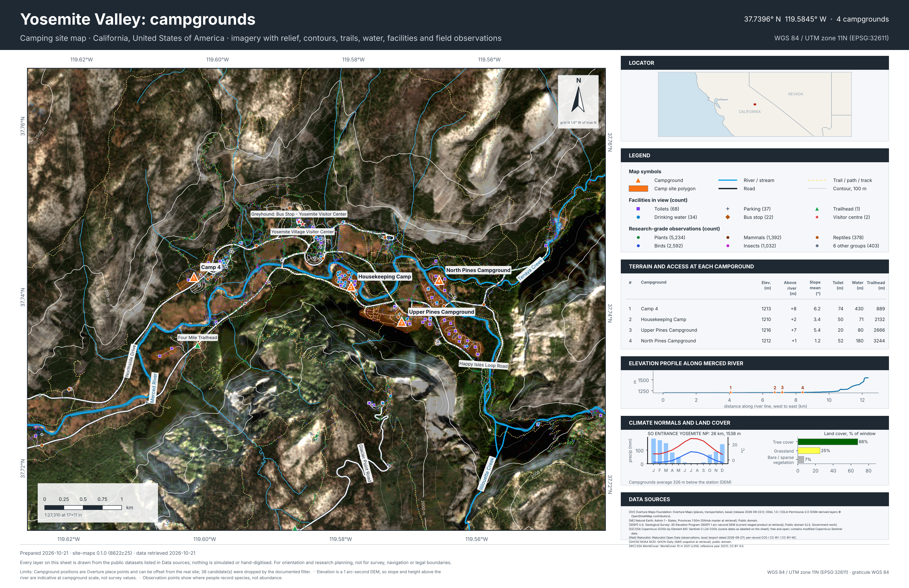

# Site Maps

Research-grade site maps built **only from cited public data**. Each sheet is 17 × 11 in, carries a labelled graticule, scale bar, true-north arrow
(with grid convergence), locator, legend and a data-sources box, and exports PNG + PDF with a provenance file listing every layer's publisher,
dataset, version and licence. Nothing is simulated or hand-drawn.

| | Site | Place |
|---|---|---|
| Environmental | Brazos Bend State Park | Texas |
| Real estate | Rainier Square | Seattle, Washington |
| Utilities | Comanche power plant (1,635 MW coal) | Colorado |
| Camping | Yosemite Valley campgrounds | California |
| Coastal / sea research | in progress | |

## Environmental: Brazos Bend State Park, Texas
Sentinel-2 imagery, ESA WorldCover land cover inside the park polygon, hydrography, 23,253 research-grade iNaturalist observations by taxon group,
monthly NDVI from clear Sentinel-2 scenes, and climate normals from the nearest long-record NOAA station.



## Real estate: Rainier Square, Seattle
Overture building footprints coloured by recorded height, streets by class with posted speeds where tagged, land use, and ring statistics at
0.25 / 0.5 / 1 mile (modelled population from Meta's HRSL, open places by category, footprint coverage, elevation range).



## Utilities: Comanche power plant, Colorado
The plant is resolved from the WRI Global Power Plant Database and matched to its Overture footprint. Transmission lines by voltage class,
towers, substations, pipelines, rail and water, with line length and tower/substation counts by distance band computed from the data.



## Camping: Yosemite Valley, California
Campgrounds from Overture places with a documented de-duplication filter, 3DEP hillshade and 100 m contours, trails, river, facilities,
per-campground slope and height above the river, the Merced River elevation profile, and station climate normals.



## Data used
Overture Maps (places, transportation, base, buildings) · Sentinel-2 L2A COGs · ESA WorldCover 2021 · USGS 3DEP elevation · NOAA GHCN-Daily ·
iNaturalist Open Data · Meta/CIESIN HRSL · WRI Global Power Plant Database · Natural Earth. Details, versions and licences are printed on each
sheet and written to `outputs/<map>.sources.md`.

## Run
```bash
pip install -r requirements.txt
PYTHONPATH=src python -m site_maps environmental   # or real-estate, utilities, camping, coastal, all
```
Rules for adding a map are in [docs/CONVENTIONS.md](docs/CONVENTIONS.md); data access notes in [docs/DATA_ACCESS.md](docs/DATA_ACCESS.md); per-map
methods and limits in `docs/`.

## Honest limits
Overture layers are OpenStreetMap-derived and can lag the ground; WorldCover is a 10 m global product; HRSL population is a model; observation
density reflects where people record species; no parcels, zoning, flood or engineering records are used because none is openly available here.
